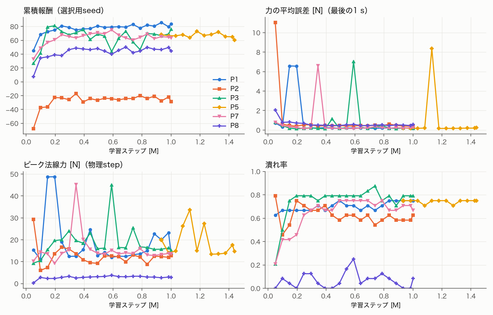

# 接触力フィードバックによる把持力制御（論文の再現とSO-101への移植）

対象論文: L. Lach, R. Haschke, D. Tateo, J. Peters, H. Ritter, J. Borràs, C. Torras,
"Zero-Shot Transfer of a Tactile-based Continuous Force Control Policy from Simulation to Robot", IROS 2024, pp. 725–732（DOI 10.1109/IROS58592.2024.10802386）。
読んだ版は arXiv:2311.07245v1（2023-11-13，題名 "Towards Transferring Tactile-based Continuous Force Control Policies from Simulation to Robot"，NeurIPS Workshop版，CC BY 4.0）。IROS版の本文は入手できなかった。
研究ページ: https://sites.google.com/view/rl-force-ctrl ／ 公式実装: https://github.com/llach/learning_fc（commit `2ee8b34`，2024-11-04）。

数値はすべて，記載したコマンドの出力から書いている。生成物（`runs/`）はgit管理外である。

## 0. ライセンスと出典

| 対象 | ライセンス | 扱い |
|---|---|---|
| `llach/learning_fc` | **LICENSEファイルなし**．README・setup.pyにもライセンス表記なし（研究ページにも記載なし） | 著作権法上は全権利留保とみなす．**コードはコピーしない**．論文の式・公開コードから読み取った設定値（数値）を参照し，本リポジトリで独自に実装する．出典は本文書とソースのコメントに書く |
| arXiv:2311.07245v1 | CC BY 4.0 | 式と設定値を出典付きで引用する |
| SO-101モデル（MuJoCo Menagerie `robotstudio_so101`） | Apache-2.0 | 変更せずに読み込む（既存と同じ） |
| 本リポジトリ | Apache-2.0 | — |

## 1. 公開実装の調査と対応表（Phase 1）

### 1.1 論文と公開実装の要点

- 対象はTIAGoの2指平行グリッパ．指ごとに独立した直動関節（0〜0.045 m）と位置サーボがあり，指先に触覚センサTA11が1つずつ付いている．制御周期は25 Hz（MuJoCo timestep 0.002 s × frame_skip 20）．
- 物体は床に置いた円柱で，指の間の把持軸上に置く．把持力の目標値 `f_goal` を観測で与え，両指の力を目標に保ちながら物体を動かさないことを目的とする．
- 柔らかさ: MuJoCoの`solimp`の`width`（ρ）で ∂f/∂q を変え，さらに**接触力の読み値に係数 fα を掛けて**「同じ位置差でも柔らかい物体ほど力が小さい」振る舞いを作っている．κ∈[0,1]で ρ∈[0.003, 0.01]，fα∈[0.5, 5] を同時に補間する（κ=0が硬い）．
  したがって論文の「変形」は，MuJoCoのsoft contactの数値的なめり込みに，センサの読み値のスケーリングを組み合わせたものであり，物体の変形状態はモデルに存在しない．

### 1.2 対応表（論文 / 公開コード / SO-101移植）

「論文」はarXiv v1の本文・付録，「コード」は`learning_fc`の`envs/gripper_env.py`，`envs/gripper_tactile_env.py`，`models/force_pi.py`，`experiments/trainings/12_obj_var.py`・`13_ah_obj_var.py`（コメントアウトされた行は数えない）．
SO-101列の「同じ」は論文に合わせたもの，「変更」はSO-101のハードウェアやこのリポジトリの制約に合わせた変更，「不可」は1自由度グリッパでは再現できないものである．

| 項目 | 論文 | 公開コード | SO-101移植 | 区分 |
|---|---|---|---|---|
| 自由度 | 2指，各指独立の直動関節 | 同じ（`finger_joint_l/r`，アクチュエータ2個） | 固定ジョー＋可動ジョー1個（ヒンジ，rad） | **変更／一部不可** |
| 制御周期 | 25 Hz | 25 Hz（0.002 s × 20） | 30 Hz（既存の制御周期・physics 0.005 sを維持） | 変更 |
| 行動 | 指ごとの位置差 a_i∈[−1,1] × Δq_max，q_des = q + a·Δq_max，Δq_max = 0.003 m | 同じ（`ControlMode.PositionDelta`） | 1次元: q_des = q + a·Δq_max（rad）．Δq_maxは指先移動量を論文程度にそろえて決める | 変更（次元） |
| 観測 | (q_i, f_i, Δf_i, a_i(t−1), h_i)，k=3でスタック | 同じ順（`Pos, Force, ForceDelta, HadCon, Action`），`FrameStack(3)`．qは[−1,1]に正規化，f・Δfは生値 | q（1），f（固定・可動の2），Δf（2），a(t−1)（1），h（2）＝8次元×3．力はスケールで正規化 | 同じ（次元のみ変更） |
| 接触フラグ | c_i = f_i > f_θ，h_i = c_i ∨ h_i(t−1) | 同じ | 同じ（ジョーごと） | 同じ |
| 観測ノイズ | σ_q = 2.7e-5 m，σ_f = 0.013 | 既定は論文と同じ．学習スクリプトは σ_f = 0.002（12）／0.01（13），f_θ = 0.02／0.0075 | σ_qはSTS3215の分解能（4096/rev，1.53 mrad）から決める．σ_fは仮想センサとして別に決める | 変更 |
| 力の定義 | 指先触覚センサの法線力 | `mj_contactForce`の**3成分（法線＋接線2）の和**×fα（pad geomと物体の接触のみ） | ジョーと物体表面の接触の**法線力**（N） | 変更（コードと論文で既に異なる） |
| 報酬 r_force | 1 − tanh(Σ_i \|Δf_i\|) | 1 − tanh(Σ_i \|Δf_i\| / f_goal) | 両方を実装し，既定は**コード版**（Nの絶対値に依存しないため） | 選択 |
| 報酬 r_obj | ȯ_y > ȯ_max なら −1 | 同じ式．ただし`ro_scale = 0`で**学習では無効**（12のスケジュールはコメントアウト，13にはなし） | 論文どおり有効にし，α2を焼きなまし | 論文に合わせる |
| 報酬 r_act | −Σ\|a_i(t−1) − a_i(t)\| | 同じ，`ra_scale = 0.2` | 同じ（α3 = 0.2） | 同じ |
| 重み | r = α1 r_force + α2 r_obj + α3 r_act | α1 = 1，α2 = 0，α3 = 0.2 | α1 = 1，α2: 0 → 1，α3 = 0.2 | 論文に合わせる |
| 帰納バイアス φ_i | 両指接触: max(0.9, 1 − \|Δf_i\|/f_goal)，片指のみ接触: 接触した指に0.1，それ以外1 | `action_bias`: 両指 clip(1−\|Δf/f_goal\|, 0.7, 1)，片指: 接触した指を**0**．ただし学習スクリプトは`with_bias=False`（既定値もFalse） | 両ジョー接触: max(0.9, 1 − mean\|Δf\|/f_goal)．片側のみ: 可動ジョーが先に接触（物体を押している）なら0.1，固定ジョーが先なら1（可動ジョーが閉じ続けないと把持できない） | **変更**（1自由度では指ごとに止められない） |
| 柔らかさ | κ→ρ（solimp width）とfα（読み値の係数） | 同じ（`change_stiffness`） | **陽な弾性体モデル**（§3）．fαは使わない | **変更**（意図的） |
| 物体 | 円柱．幅w_o，把持軸方向の位置o_y | `wo`は円柱の**半径**（`size[0]`），0.015〜0.035 m | 箱．把持方向の幅，固定ジョーとのすき間（接触位置），剛性，摩擦，質量 | 変更 |
| 位置の制約 | \|o_y\| + r_o < q_max，r_o − d_p > \|o_y\|，d_p < r_o | `oy_max = min(0.97·0.045 − wo, wo − 2·xi_max)` | すき間は固定ジョーとの距離として直接与える | 変更 |
| アクチュエータDR | biasprm b2 ∈ [−13, −6]（kv相当） | 範囲は定義されているが，`sample_biasprm`の分岐がコメントアウトされ**常にb2 = −9** | グリッパのkv（・減衰）をスケールでランダム化 | 論文に合わせる |
| 目標力 | f_goal ∈ [f_min, 0.97 f_max(κ)] | 同じ（FGOAL範囲） | f_goal ∈ [f_min, 物体の変形上限とトルク上限から決まる値] | 変更（単位はN） |
| カリキュラム | α2: 0→1，ȯ_max: 2e-4→5e-5，W_o: [0.020,0.025]→[0.015,0.035]，O_y: [0,0]→[−0.04,0.04]（線形，s_end） | 12: W_o・O_y・ȯ_maxのみ（s_end = 1.5M），13: W_o・O_y＋未使用の`ah_*` | 論文の4項目をSO-101の範囲に換算 | 論文に合わせる |
| アルゴリズム | PPO | SB3 PPO（**改造版フォーク**），`MlpPolicy` [50, 50]，lr 6e-4，10環境，episode 150 step，その他はSB3既定 | SB3 PPO（既存の依存），同じネットワーク・lr・episode長 | 同じ |
| 学習量 | 研究ページ: 4M step | 3.5M（12）／4.5M（13） | 小規模で成立を確認してから決める | — |
| ベースライン | Lach et al. 2022の力制御器のPython実装 | `ForcePI`: 接触まで一定速度で閉じ，両指接触後にPI（Δq = Kp·Δf/k + Ki·∫Δf/k dt，Kp=0.18，Ki=1.13，k=160）．`StaticModel`: 固定位置 | 力PI（同じ構造，SO-101の剛性で再調整）＋固定指令 | 同じ構造 |
| 評価（シミュ） | κを11点×200試行，他は毎回ランダム．指標は累積報酬 | `tactile_eval`: 目標力の等間隔列でForcePIと比較 | 同じプロトコル＋力追従誤差・最大力・物体移動・持ち上げ保持 | 拡張 |
| 評価（実機） | 6物体×20試行（IROS版は研究ページによると10物体），報酬と物体移動 | `robot/` | 実機なし（対象外） | **不可** |

### 1.3 公開コードと論文の食い違い（再現時に注意する点）

1. 報酬 r_force の正規化（f_goalで割るか）が異なる．
2. 帰納バイアスの下限（0.9 / 0.7）と片指接触時の係数（0.1 / 0）が異なり，公開の学習スクリプトはバイアスを**使っていない**（`with_bias=False`）．論文のπ_IBを再現する設定は公開コードからは特定できない．
3. 物体移動の罰（r_obj）は，公開スクリプトでは重み0で無効．
4. アクチュエータのDR（b2）は，公開コードでは実際には行われない．
5. 力は接線成分を含む3成分の和で，論文の「法線力」と異なる．
6. 論文の柔らかさは物理的な変形ではない（ρは数値的なめり込み，fαは読み値の係数）．

### 1.4 SO-101の1自由度グリッパで再現できない要素

- **片指ずつの接触獲得**（帰納バイアスの本来の働き）: 論文では，先に触れた指を止め，もう一方の指が触れるまで待つことで，中心からずれた物体を押さずに挟める．SO-101は固定ジョーが動かないので，物体が可動ジョー側に寄っていれば，固定ジョーに当たるまで物体を押すしかない．グリッパだけでは物体の移動を避けられない（腕を把持方向へ動かせば「2本目の指」の代わりになるが，それは論文の範囲外の拡張になる）．
- **指ごとの力の独立制御**: 力は1つの指令で決まる．静止時は両ジョーの法線力がほぼ等しい（§2）．
- **実機の触覚センサ**: SO-101には指先の力センサがない．本研究の力観測はシミュレーションの接触力（仮想センサ）である．実機で使うには，センサの追加か，サーボの負荷（電流）からの推定が必要になる．
- **実機評価・sim-to-real**: 実機がないため行わない．

## 2. 既存SO-101モデルでの「位置指令 → 法線力」（Phase 2）

```bash
cargo run --release -p mujoco-runtime --example grip_command_probe -- 3000000 5 \
  > runs/force-control/grip_command_probe.jsonl
```

既存シーン（`so101_pick_place.xml`，25 mm立方体，DRなし）．IK GraspのClose開始で腕の指令を固定し，グリッパ指令を2 mrad/周期で閉じて両ジョーが触れた角度を接触角 q_c とする（接触判定は法線力0.05 N）．
その後，指令を δ = q_cmd − q_c の各値に1 s（30周期）ずつ保持し，最後の1/3の平均を記録した．seed 3,000,000〜004，質量20 g / 100 g，トルク上限 1.0倍（2.94 N·m）/ 0.5倍（1.47 N·m）．
q_cは0.130〜0.134 rad．0.5倍・seed 3,000,003だけは，閉じる途中で両ジョーの接触がそろわず計測できなかった（各4 seed）．

片側の法線力（N，固定・可動ジョーの平均．両者の差は最大0.6 N）:

| δ (mrad) | +4 | 0 | −1 | −2 | −4 | −6 | −10 | −20 | −50 | −100 | −300（既存の閉指令相当） |
|---|---|---|---|---|---|---|---|---|---|---|---|
| 2.94 N·m・20 g | 0.1 | 0.5 | 0.8 | 1.0 | 1.5 | 2.1 | 3.6 | 11.2 | 31.5 (飽和) | 35.5 (飽和) | 37.1 (飽和) |
| 2.94 N·m・100 g | 0.4 | 1.8 | 2.8 | 3.8 | 5.8 | 8.0 | 13.5 | 35.5 (飽和) | 37.8 (飽和) | 38.9 (飽和) | 39.3 (飽和) |
| 1.47 N·m・20 g | 0.1 | 0.6 | 0.8 | 1.1 | 1.6 | 2.2 | 3.7 | 11.4 | 15.4 (飽和) | 17.1 (飽和) | 18.3 (飽和) |
| 1.47 N·m・100 g | 0.5 | 2.1 | 3.2 | 4.1 | 6.2 | 8.5 | 14.1 | 18.0 (飽和) | 19.1 (飽和) | 19.6 (飽和) | 19.8 (飽和) |

同じ条件での最大めり込み（mm）とジョー角の沈み込み q − q_c（mrad）:

| δ (mrad) | 0 | −4 | −10 | −20 | −300 |
|---|---|---|---|---|---|
| 2.94 N·m・20 g: めり込み / q − q_c | 0.14 / +0.2 | 0.27 / −3.9 | 0.49 / −9.6 | 0.85 / −19.0 | 1.66 / −38.7 |
| 2.94 N·m・100 g | 0.13 / +0.3 | 0.25 / −3.5 | 0.44 / −8.9 | 0.72 / −16.1 | 0.76 / −17.0 |

分かったこと:

1. **飽和の原因は指令値である**．既存の閉指令−0.17 radは接触角（約0.13 rad）より約300 mrad内側にあり，トルクは常に上限に張り付く（PHYSICS_AUDIT.md §1.2と一致）．指令を接触角から約−20 mrad以内に置けば飽和せず，力は指令に対して単調に増える．**位置指令による力の調整そのものは可能である**．
2. **力と角度の関係を決めているのは物体の変形ではなく，MuJoCoのsoft contactである**．非飽和域では q が指令にほぼ追従し（トルクは0.1〜1.1 N·mで，kp = 998 N·m/radの位置サーボはほとんど誤差を出していない），ジョーが沈み込んだ分だけ接触が「めり込んで」力が出る．傾き（−4 → −10 mrad）は20 gで約0.35 N/mrad，100 gで約1.3 N/mradと，**同じ立方体でも質量によって4倍近く違う**．これは加速度ベースのsoft contactの性質（PHYSICS_AUDIT.md §1.3）による人工的な依存で，材料の柔らかさではない．
3. 指令1 mradあたりの力の変化は0.35〜1.3 N．STS3215の位置分解能は1.53 mrad（4096/rev）なので，実機の位置指令だけで1 N未満の精度を出すのは難しい．シミュレーションでは連続値を指令できる．
4. めり込みは飽和時に1.66 mm（20 g）/ 0.76 mm（100 g）．Graspの衝突的な閉じ方で見られた1.3〜2.7 mm（PHYSICS_AUDIT.md §1.3）よりは小さいが，指先球の半径0.75 mmを超える．
5. ゆっくり閉じても，固定ジョーとのすき間の分だけ立方体は0.7〜2.2 mm押され，その後の締め付けで合計1.3〜3.4 mm動いた．

注意: §3.2で分かったとおり，このシーン（物体中心の高さ12.5 mm）では，閉じる途中でジョーのメッシュがテーブルに触れることがある．上の値にはその影響が含まれている可能性がある（腕の指令は固定しているが，テーブルからの反力で手首が動きうる）．

これを受けて，力制御環境では次の方針をとる．

- 物体の柔らかさは，接触のめり込みではなく**陽な弾性要素（ばね・ダンパ）**で表す．力と変形の関係は F = k·d + c·ḋ で，d は関節変位として直接読める．
- ジョーとの接触面は物体の質量に依存しない一定の質量の板にする．数値的なめり込みは物体の変形とは別の量として記録する．
- 既存のシーン・グリッパの力・接触パラメータは変えない（新しいシーンとして分離する）．

## 3. 独立した把持力制御環境（Phase 3）

実装: `crates/mujoco-runtime/src/force_grasp.rs`（`ForceGraspSim`，`CompliantObject`，`ForceGraspRanges`，`ForceReading`，`ForcePi`），シーン `scenes/so101_force_grasp.xml`，モデル書き換え用のCヘルパ `model_access.c`（`robot_sim_set_box` / `set_body_pos` / `set_slide`）．
既存のPick & Placeとはシーンもモジュールも別である．共通部分として，`PickPlaceSim::from_scene`（同じ名前の要素を持つ別シーンを読む）を追加した．既存の`PickPlaceSim::new`の挙動は変えていない（テストで軌道のビット一致を確認）．
論文の公開コードは使わず，論文の記述から実装した．

### 3.1 柔らかさのモデル（力と変形の関係を陽に持つ）

物体は，剛体の芯（freejoint）と，その4側面に付けた表皮板からなる．表皮板は，ばね・ダンパ付きのスライド関節で芯につながっている．

- 変形 d（m）は**板の圧縮量**（関節変位）で，状態として直接読める．力と変形の関係は，板1枚あたり **F = k·d + c·ḋ**（0 ≤ d ≤ travel）である．
- d = travel に達すると板は芯に当たり（硬い関節リミット），それ以上の力はばねを通らない．これを`bottomed`（潰れた状態）として区別する．
- ジョーとの接触は板が受け持つ．接触のパラメータはSO-101のpadをそのまま使い，板のgeomにはpriority 2・solimp (0.99, 0.99, 0.001)・friction（DRの値）を持たせた．
  板にはarmature 0.1 kgを持たせた．これで接触の有効質量が物体の質量によらず一定になり，5 ms刻みでばねが安定する．
  そのため速い衝突では，板が重い板のように振る舞う（質量は2 gで重力には効かない）．
- **数値的なめり込み（`penetration`）は変形とは別の量として記録する**．1 mmを超えたら幾何的に無効な接触（板がpadに食い込んだ状態）とみなす（`PENETRATION_LIMIT`）．
- 論文のfα（センサ読み値の係数）は使わない．

| 物体パラメータ | 既定の範囲（`ForceGraspRanges::default`） | 論文での対応 |
|---|---|---|
| 外寸の幅 | 22〜30 mm（高さ40 mm） | W_o（円柱半径0.015〜0.035 m） |
| 固定ジョーとのすき間（接触位置） | 4〜8 mm | O_y |
| 剛性 k | κ∈[0,1]で対数補間，5000（硬）〜200（柔）N/m | κ（ρとfαを補間） |
| 減衰 c | 板の臨界減衰の0.3〜1.0倍 | （なし） |
| 最大圧縮 travel | 3〜6 mm（幅/2 − 8 mmが上限） | d_p |
| ジョーとの摩擦 μ | 0.3〜1.5 | （なし） |
| 芯の質量 | 10〜100 g（板4枚で＋8 g） | 物体質量0.2 kg固定 |

### 3.2 エピソードの開始

ScriptedGrasp（IK）でApproach→Descendを行う．その際，固定ジョーを「(幅/2 − 12.5 mm) + すき間 + 1 mm」だけ物体から離す．
Close相の間も開いたまま追従を続けて腕を収束させ，そこで腕の指令を固定する．以後はグリッパだけを指令する．

開発中に分かったこと:

1. **Descendは目標から3 mm以内で終わるため，そのまま固定すると腕の位置が試行ごとに最大3 mmずれる．** Close相の15周期も追従を続けるように直した．
2. **物体中心が高さ12.5 mm（既存の25 mm立方体と同じ）では，閉じる途中で可動ジョーの凸包メッシュがテーブルを最大40 Nで押し，固定した腕（shoulder_panで46 mrad）を押し戻した．** 開始時点でも固定ジョーのメッシュが1 Nでテーブルに載っていた．
   力制御環境では物体を高さ40 mm（中心20 mm）にして，テーブル接触をなくした．**既存のPick & Placeでも，Close中にジョーがテーブルに触れている可能性がある**（未検証．既存環境は変更していない）．
3. 板が3 mm厚では，強く押し込むと指先のpad boxに2 mm食い込み，見かけ上60〜490 Nの力が出た．板を5 mm厚にし，関節リミットを硬くした（solreflimit 0.01，solimplimit 0.99/0.999）．

すき間の校正（`force_grasp_probe calibrate 5000000 10`，k = 5000 N/m，travel 3 mm）．「押し出し」は，両ジョーが接触するまでに可動ジョーが物体を押した距離で，固定ジョーとの実際のすき間に当たる．

| 幅 | 要求すき間 3 mm | 4 mm | 6 mm | 8 mm |
|---|---|---|---|---|
| 22 mm: 押し出し平均（最小〜最大） / 降下中の物体移動の最大 | 3.06（2.90〜3.22）/ 0.00 | 4.06（3.92〜4.23）/ 0.00 | 6.07 / 0.00 | 8.29（7.89〜9.30）/ 0.00 |
| 26 mm | 3.03 / 0.04 | 4.07 / 0.01 | 6.15 / 0.00 | 8.21 / 0.00 |
| 30 mm | 3.63（3.07〜4.71）/ 1.35 | 4.15（3.87〜4.38）/ 0.23 | 6.21 / 0.00 | 8.16 / 0.00 |
| 32 mm | 4.48（〜14.67）/ 17.29 | 4.48 / 0.98 | 6.36 / 0.03 | 8.36 / 0.00 |
| 35 mm | 6.55（〜22.44）/ 19.14 | 4.35 / 29.41 | 6.39 / 6.28 | 8.14 / 0.01 |

幅30 mm以下・すき間4 mm以上なら，降下中にジョーが物体へ触れる量は0.23 mm以下だった．これを既定の範囲とした．
幅32 mm以上や小さなすき間では，降下中に物体を倒すことがある（Graspの開き0.6 radによる制約）．

### 3.3 力と変形の検証（`force_grasp_probe static 5000000 3`）

既定の物体（幅30 mm，すき間4 mm，travel 4 mm）．両ジョーが触れた角度 q_c から，指令を δ ずつ内側にして1.5 s保持し，最後の0.5 sの平均をとった（3 seed）．値は固定 / 可動ジョーの順．

| k (N/m)・芯の質量 | δ (mrad) | ジョーの法線力 (N) | ばね力 k·d + c·ḋ (N) | 変形 d (mm) | めり込み (mm) |
|---|---|---|---|---|---|
| 1000・20 g | −20 | 0.92 / 0.93 | 0.92 / 0.93 | 0.92 / 0.93 | 0.041 |
| 1000・20 g | −80 | 3.15 / 3.00 | 3.15 / 3.00 | 3.15 / 3.00 | 0.131 |
| 1000・100 g | −40 | 2.39 / 3.23 | 2.39 / 3.23 | 2.39 / 3.23 | 0.058 |
| 5000・20 g | −40 | 6.88 / 6.97 | 6.88 / 6.98 | 1.38 / 1.40 | 0.229 |
| 5000・20 g | −80 | 13.45 / 13.51 | 13.45 / 13.51 | 2.69 / 2.70 | 0.415 |
| 5000・100 g | −40 | 7.02 / 8.57 | 7.03 / 8.53 | 1.40 / 1.71 | 0.108 |
| 200・20 g | −40 | 0.58 / 0.73 | 0.58 / 0.73 | 2.88 / 3.67 | 0.034 |
| 200・20 g | −80（潰れ） | 22.16 / 22.17 | 0.84 / 0.84 | 4.19 / 4.19 | 0.582 |
| 1000・20 g | −160（潰れ） | 39.06 / 39.06 | 4.29 / 4.29 | 4.29 / 4.29 | 0.816 |

- 潰れる前は，**ジョーの法線力がばねの法則と一致した**（差は0.05 N以内）．力は板の変形で決まり，質量20 gと100 gで同じ k·d の関係になった．
- 数値的なめり込みは0.02〜0.42 mmで，変形（0.9〜3.7 mm）より小さい．質量による差は2倍程度残る（k = 5000・δ = −40で0.229 / 0.108 mm）．
- 潰れた後（`bottomed`）は，力がばねを通らず関節リミットを通って39 N（トルク上限）まで上がる．
- 未解決: k = 5000・100 g・δ = −80 mrad の1 seedで，めり込み1.9 mm・見かけ上266 Nの無効な接触が起きた．`PENETRATION_LIMIT`で検出できる．
- 両ジョーの力の差は，物体を固定ジョーへ押し付けている間のテーブル摩擦の分である（可動側が大きい）．

## 4. 接触力制御の成立性（Phase 4の前段，学習なし）

`force_grasp_probe control 6000000 20`: 物体は`ForceGraspRanges::default()`からseedごとに抽出した．
目標力はseedごとに [0.3 N, min(0.8·k·travel, 8 N)] から一様に選んだ（論文と同じく，物体が耐えられる力の範囲から選ぶ）．
1エピソード150周期（5 s），両コントローラは同じ物体・同じ目標で比べた．

- **固定指令**: 既存のGraspと同じ閉指令 −0.17 radを出し続ける．
- **力PI**（`ForcePi::default()`）: 論文のベースライン（Lach et al. 2022）と同じ構造．0.6 rad/sで閉じ，両ジョーの接触（0.05 N）後は q_des = q − (Kp·e + Ki·∫e dt)，e = (f_goal − 平均力)/k̂．
  Kp = 0.5，Ki = 2.0，k̂ = 100 N/rad，|Δq| ≤ 0.03 rad/周期．ゲインと閉じ速度は小さな探索（速度0.15 / 0.3 / 0.6 rad/s × ゲイン4組，各20 seed）で選んだ．遅い閉じ方では150周期以内に収束しない例があった．

| 20試行（目標 0.34〜4.47 N） | 固定指令 −0.17 rad | 力PI |
|---|---|---|
| 最後の1 sの平均力（両ジョーの平均） | 38.70 N（目標の平均38倍） | 目標との差: 平均0.001 N，最大0.005 N |
| ジョーごとの相対誤差（平均 / 最大） | 38.3 / 113.4 | 0.13 / 1.00 |
| 潰れ（最終時点で`bottomed`） | **20/20** | 1/20 |
| ピーク力（平均 / 中央値 / 最大） | 70.5 / 58.8 / 196.6 N | 11.2 / 6.6 / 34.3 N |
| 無効な接触が起きた試行 | 15/20 | 2/20（各1周期） |
| 芯の水平移動（平均 / 最大） | 10.9 / 13.0 mm | 7.6 / 10.7 mm（すき間の平均6.0 mm） |

結論:

- **位置差の指令と接触力のフィードバックで把持力を目標に保つ制御は，この環境で成立する．** 力PIは20試行すべてで平均力を目標の±0.005 N以内に保った．学習（PPO）に進んでよいと判断する．
- 固定の閉指令は，どの物体も潰す（ストールトルクで39 N）．
- 力PIの課題は**接触直後のピーク**（中央値6.6 N，最大34 N）である．可動ジョーが先に当たると，物体をすき間の分だけ全速で押し渡す．柔らかい物体では可動側の板がその間に潰れ，芯を硬く押した状態で固定ジョーに衝突する．
  これは1自由度グリッパに特有の現象で，論文の帰納バイアス（片側接触の間は行動を0.1倍にする）が抑えようとした区間に当たる．RLとの比較では，追従誤差に加えてこのピークと潰れを主な指標にする．
- 力PIの1試行（seed 6,000,007，k = 253 N/m）では，衝突の後で固定ジョーの接触が外れた．それでも平均力で制御するため，可動側だけで目標の2倍の力を出し続けた．
  ほかの試行のジョー間の差（相対6〜30%）は，テーブル摩擦との釣り合いによる実際の差である．

## 5. 次の作業（2026-11-01時点の計画．§6以降で実施）

1. Python binding・Gymnasium環境・PPO（§6〜7）．
2. 論文の学習設定での学習と，固定指令・力PIとの比較（§7〜8）．
3. 把持の後のIK持ち上げ・保持の評価（未実施）．
4. 破損しきい値を加えた安全なPick & Place（未実施．論文の再現とは別の実験として扱う）．

### 再現コマンド

```bash
cargo run --release -p mujoco-runtime --example grip_command_probe -- 3000000 5      # §2
cargo run --release -p mujoco-runtime --example force_grasp_probe -- calibrate 5000000 10   # §3.2
cargo run --release -p mujoco-runtime --example force_grasp_probe -- static 5000000 3       # §3.3
cargo run --release -p mujoco-runtime --example force_grasp_probe -- control 6000000 20     # §4
cargo run --release -p mujoco-runtime --example force_grasp_probe -- control 6000000 20 KP KI K SPEED  # PIのみ
cargo test -p mujoco-runtime --test force_grasp   # 6件
```

## 6. Gymnasium環境とPPO（2026-11-01）

実装:
- Rust: `ForceGraspSim::step`が制御周期内の物理ステップ（5 ms，6〜7回）ごとの極値`StepStats`を返す（面の最大・最小法線力，芯などへの力，最大圧縮，潰れ，めり込み，トルク）．
  `Simulator::step_control_observed`は物理ステップごとのフックで，既存の`step_control`はこれを空のフックで呼ぶ（既存の計測出力がバイト単位で一致することを確認）．
- Rust: `Positioning::Teleport`はScripted Graspと同じ降下目標をIKで1回解き，腕をその姿勢に静止状態で置く（reset時のみ，`Simulator::teleport`）．
  すき間の幾何は従来方式と0.1〜0.3 mm以内で一致し，リセットは0.42 s → 0.05 sになった．
- Python: `ForceGraspSimulator`・`ForcePi`のbinding，`robot_sim.force_grasp_env.ForceGraspEnv`，`force_grasp_learning`（学習・評価），`examples/python/train_force_grasp_ppo.py`・`eval_force_grasp.py`・`analyze_force_grasp_impact.py`，`scripts/plot_force_grasp_curves.py`．

### 6.1 MDP（`ForceGraspConfig`の既定値）

| 項目 | 設定 | 論文 / 公開コードとの関係 |
|---|---|---|
| 観測（1フレーム10次元×3スタック） | グリッパ角（[−1,1]に正規化），角速度，固定・可動ジョーの法線力，Δf_i = f_goal − f_i，目標力，前回の（バイアス適用後の）行動，接触フラグ2つ．力は10 Nで割る | 論文の(q, f, Δf, a(t−1), h)に角速度と目標力を加えた．物体の剛性・減衰・摩擦・質量・幅・すき間は観測しない（テストで確認） |
| ノイズ | σ_q = 0.44 mrad（STS3215の量子化1.53 mrad/√12），σ_f = 0.01 N，接触しきい値 f_θ = 0.05 N | 論文 σ_f = 0.013（独自単位）．誤検出しないようf_θ = 5σ_f |
| 行動 | a∈[−1,1]，q_des = q_obs + φ·a·Δq_max，Δq_max = 0.02 rad/周期（0.6 rad/s，指先で約1.6 mm）．指令は連続値（`command_resolution = 0`） | 論文のposition delta．硬い物体では接触後1 mradで約0.4 Nなので，接触前の速さと接触後の分解能の兼ね合いで0.02にした |
| 初期状態 | 高速配置の後，グリッパを0.42 radまで開ループで閉じてから開始（エピソードには数えない）．最初の接触は0.146〜0.38 radなので，接触まで最大行動で2〜14ステップ | 論文は全開の指が物体の数ステップ手前にある．0.6 rad（全開）から始めると11〜23ステップかかり，探索が成立しなかった（§7.1） |
| 物体・目標のランダム化 | 幅・すき間（カリキュラム），κ∈[0,1]（剛性5000〜200 N/m），減衰比，travel，摩擦0.3〜1.5，質量10〜100 g，グリッパ減衰×0.7〜1.4（論文のb2に相当）．目標力は [0.3 N, min(0.8·k·travel, 8 N)] から一様 | 論文: f_goal < f_max(κ) |
| 報酬 `paper` | r = α1·r_force + α2·r_obj + α3·r_act．r_force = 1 − tanh(Σ\|Δf_i\|/f_goal)，r_obj = −1（物体の水平速度 > ȯ_max），r_act = −\|a_t − a_{t−1}\|（生の行動）．α1 = 1，α3 = 0.2，α2: 0→1（カリキュラム） | r_forceは公開コードの正規化版．r_objは論文どおり（公開スクリプトは重み0）．ȯ_max = 5.0→1.25 mm/s（論文の2e-4→5e-5 m/stepを25 Hzで換算） |
| 帰納バイアス φ | 接触前1，可動ジョーだけ接触0.1（`bias_single_moving`），固定ジョーだけ1，両方 max(0.9, 1 − mean\|Δf\|/f_goal) | §1.2のSO-101版 |
| カリキュラム | 学習ステップの最初の1/3で線形に: 幅 [25,27]→[22,30] mm，すき間 [4,5]→[4,8] mm，α2，ȯ_max | 論文Table 2（s_end = 1.5M / 4.5M） |
| エピソード | 150周期（5 s）でtruncated．terminatedはシミュレーションのエラー時のみ | 論文と同じ（`_is_done`は常にFalse） |

### 6.2 PPO（`train_force_grasp_ppo.py`）

SB3 2.x PPO，MlpPolicy [50, 50]，lr 6e-4，n_steps 1024/env × 6環境（SubprocVecEnv），batch 64，n_epochs 10，γ 0.99，GAE λ 0.95，clip 0.2，ent 0，vf 0.5，max_grad_norm 0.5，seed 42，CPU．

| 論文の公開コードとの違い（`config.json`に記録） |
|---|
| 並列環境6（公開コード10．M1は7並列以上で遅くなる） |
| n_steps 1024/env（公開コード: SB3既定2048） |
| SB3は改造なしの2.9.0（公開コードは改造版フォーク） |
| 30 Hz・可動ジョー1つ |
| 学習量は1M step（研究ページ: 4M） |

チェックポイントは選択用seed（7,000,000〜7,000,023の24試行，カリキュラム終端，決定論的方策）で49,152 stepごとに評価し，累積報酬が最大のものを`best.zip`とした．最終評価seed（8,000,000〜）とは分けている．
学習中は`progress.csv`（SB3），`selection.jsonl`，`checkpoints/step_N.zip`，`best.zip`，`final.zip`，`config.json`を保存する．既存の出力先には書き込まない．

## 7. 学習の経過（`runs/force-grasp-ppo/`）

| run | 設定 | step | 所要時間 | 結果 |
|---|---|---|---|---|
| smoke-paper-s42 | 初期開き0.6 rad，φあり，α2 0→1 | 3,072 | 18 s | 動作確認のみ |
| short-paper-s42 | 同上 | 30,720 | 149 s（201 step/s） | 接触0．停滞 |
| smoke2 / short2-paper-s42 | 初期開き0.42 rad・高速配置，φあり | 3,072 / 30,720 | 2 s / 15 s | 両ジョー接触0．停滞 |
| short2-paper-nobias-s42 | φなし | 30,720 | 15 s | 接触5% → 0%（回避を学習） |
| abl-a / abl-b | α2 = 0，φなし / あり | 104,448 | 53 s / 50 s | 学習が進む（選択用報酬 83.8 / 27.3） |
| **P1** p1-code-noobj-nobias-1m | α2 = 0，φなし（公開スクリプト相当） | 1,001,472 | 403 s | best 93.4万step（報酬85.6） |
| **P2** p2-paper-obj-bias-1m | α2 0→1，φ = 0.1（論文相当） | 1,001,472 | 394 s | best 34.4万step（報酬 −17.1） |
| **P3** p3-paper-obj-nobias-1m | α2 0→1，φなし | 1,001,472 | 398 s | best 19.7万step（報酬81.0） |
| P4 p4-code-peak-1m | P1＋ピーク罰（毎周期，重み1） | 1,001,472 | 304 s | 失敗: 常に全開（接触0） |
| P5 p5-p1best-peakmax-w5 | P1のbestから＋ピーク罰（最大値の増分，重み5） | +503,808 | 225 s | ピーク力は下がらない |
| P6 p6-code-peakmax-w5-1m | P1設定＋同じ罰をゼロから | 1,001,472 | 313 s | 失敗: 常に全開 |
| P7 p7-…anneal0to5-1m | 罰の重みを0→5で焼きなまし | 1,001,472 | 398 s | best 59.0万step．ピーク力は下がらない |
| **P8** p8-…anneal0to20-1m | 罰の重みを0→20で焼きなまし | 1,001,472 | 357 s | best（選択用報酬50.2）．ピーク力・潰れが大幅に低下 |

学習の合計は約8.7M step，約53分（1M stepのrunは2,478〜3,294 step/s）．



選択用seed（24試行）での決定論的方策の推移．累積報酬は報酬の定義がrunごとに異なるので，run間では比べられない（P2はr_obj，P5/P7/P8はピーク罰を含む）．

### 7.1 停滞の分析（ステップ数を増やす前に行ったもの）

1. **全開から始めると接触しない**（short-paper）: 接触までΔq_maxで11〜23ステップ必要で，平均0の行動のランダムウォーク（150ステップで標準偏差0.24 rad）ではほとんど届かない．決定論的方策は閉じず，r_actを減らすことだけを学んだ（stdが1.0→0.76）．
   → 初期開き0.42 rad（接触まで2〜14ステップ）にした．
2. **SO-101版の帰納バイアスは探索を止める**（short2-paper）: 可動ジョーだけが触れている間φ = 0.1になり，すき間4〜8 mm（0.05〜0.1 rad）を押し渡すのに25〜50ステップぶん閉じ続ける必要がある．0.1倍のランダムウォークでは届かず，両ジョー接触は0%だった．
   論文の2指では，片指が止まってももう一方の指は全速で動けるため，この問題は起きない．
3. **r_objによる接触回避**（short2-nobias）: 1自由度では物体のすき間の押し渡しが避けられず，接触すると毎ステップr_obj = −1を受ける．接触しなければ罰はないため，方策は接触を避けるようになった（接触5% → 0%）．
   論文自身が述べる局所解で，論文は1.5M stepのカリキュラムで回避している（ここでは10k stepに圧縮していた）．公開スクリプトはそもそもr_objの重みが0である．
4. 行動の飽和（\|a\| ≥ 1）は初期に30%．学習後はP1で6〜8%，P2で12〜23%だった．

## 8. 固定指令・力PI・PPOの比較（最終評価seed 8,000,000〜8,000,199）

同じseed・同じ物体・同じ目標力・同じセンサノイズ列．PPOは各runの`best.zip`（決定論的），力PIは§4と同じゲインで，PPOと同じノイズ付き観測を使う．
ピーク力はMuJoCoの物理ステップ（5 ms）ごとの最大値である．`runs/force-grasp-eval/final-200`（固定・PI・P1〜P5），`final-200-peak`（P6〜P8）．

定義:
- 誤差は最後の1 s（30周期）の真の法線力（ノイズなし）と目標の差を，ジョーごとに平均したもの．
- 安定把持は，平均力の誤差が max(0.1·f_goal, 0.05 N) 以内で両ジョーが接触した状態が，最後まで続いた最初の時刻．
- 潰れは，いずれかの物理ステップで面が最大圧縮に達したこと．
- 成功 = 両ジョー接触あり・無効接触なし・潰れなし・最後の1 sで接触喪失なし・平均誤差が許容内．
- 無効接触（めり込み1 mm超）と接触喪失は成功に含めず，別に数えた．

| 指標（200試行） | 固定指令 | 力PI | P1 | P2 | P3 | P5 | P7 | P8 |
|---|---|---|---|---|---|---|---|---|
| 成功率 | 0.0% | 16.5% | 15.0% | 14.5% | 7.5% | 15.5% | 13.5% | 17.0% |
| 1. 平均誤差 N | 60.723 | 0.278 | **0.208** | 2.697 | 1.694 | 0.934 | 0.887 | 0.549 |
| 1. 最大誤差 N | 81.090 | 0.667 | **0.460** | 7.171 | 3.571 | 2.215 | 1.907 | 0.740 |
| 2. ピーク法線力 平均 N | 213.53 | 20.12 | 13.62 | 23.68 | 26.16 | 17.45 | 17.40 | **3.39** |
| 2. ピーク 平均 N（有効接触のみ） | 90.10 | 16.45 | 13.32 | 10.94 | 19.93 | 14.40 | 14.74 | **2.28** |
| 2. ピーク 最大 N（有効接触のみ） | 143.0 | 46.4 | 33.8 | 37.4 | 41.2 | 38.3 | 36.8 | **18.0** |
| 2. ピーク 最大 N（全試行） | 1293.9 | 615.3 | 69.0 | 675.6 | 711.6 | 380.9 | 505.5 | 44.9 |
| 2. 保持中のピーク N | 86.66 | 6.25 | 4.30 | 16.31 | 9.19 | 5.96 | 8.50 | 2.62 |
| 3. 潰れ率 | 99.5% | 66.5% | 65.0% | 53.5% | 73.0% | 65.5% | 66.5% | **5.0%** |
| 4. 安定把持まで s（到達した試行の平均） | — | 1.94 | 2.14 | 3.50 | 1.82 | 2.07 | 1.98 | 2.18 |
| 4. 安定把持に到達 | 0 | 161 | 159 | 146 | 153 | 163 | 171 | 82 |
| 5. 物体移動 mm | 11.0 | 7.3 | 7.5 | 8.1 | 8.1 | 7.7 | 7.7 | 4.0 |
| 6. 両ジョー接触の維持 | 100.0% | 76.7% | 88.0% | 89.4% | 93.6% | 89.5% | 90.5% | 45.1% |
| 無効接触（めり込み>1 mm） | 91.0% | 30.0% | 35.0% | 32.0% | 42.0% | 35.0% | 36.0% | 15.5% |
| 片側ジョーの接触喪失（最後の1 s） | 0.0% | 22.5% | 9.0% | 23.5% | 4.0% | 9.5% | 11.0% | 3.0% |
| ピークの時点: 押し渡し中 / 固定ジョー接触時 / 保持中 | 0 / 196 / 4 | 48 / 133 / 19 | 98 / 98 / 4 | 19 / 143 / 38 | 42 / 149 / 9 | 81 / 115 / 4 | 80 / 111 / 5 | 58 / 32 / 20 |

P4・P6は全試行で接触せず（成功0%，誤差2.152 N）．
物体移動には，すき間（4〜8 mm）を押し渡す分と固定側の圧縮分が含まれる（1自由度では避けられない）．

**論文のプロトコル**（κを11点 × 20試行，他は毎回抽出．`runs/force-grasp-eval/kappa11x20`）の全体: 固定 成功0%・誤差68.6 N，力PI 18.2%・1.79 N，P1 15.5%・0.180 N，P2 19.5%・0.883 N，P8 22.3%・0.501 N．
κ = 1.0（最も柔らかい）では，力PI・P1・P2の潰れ率はいずれも100%．P8はκ ≥ 0.8で両ジョー接触の維持が0〜5%（ほぼ把持しない）．

### 8.1 結果のまとめ

- **論文ベースの報酬で学習は成立した．** ただし「論文どおり」の構成（r_objあり・SO-101版φ = 0.1，P2）は，1自由度の制約で累積報酬が負のまま（−17）で，追従誤差も2.7 Nと大きかった．
  公開スクリプト相当（r_objなし・φなし，P1）が最も良く追従した（平均誤差0.208 N，力PIの0.278 Nより小さい）．
- P1は力PIと比べて，追従誤差・ピーク力（平均13.6 vs 20.1 N，全試行の最大69 vs 615 N）・接触喪失（9.0 vs 22.5%）が小さい．ただし潰れ率（65%）と成功率（15%前後）は変わらない．
- **論文ベースのPPOはピーク荷重を抑えられなかった．** ピークの大半は固定ジョーへの衝突時と押し渡し中に出ている．

## 9. 接触開始時の過負荷を抑える報酬（独自拡張，別実験）

報酬 `paper_peak`: r += −w · Δmax(over)．over = min(max(0, F_peak − 1.5·f_goal)/f_goal, 5) で，F_peakは制御周期内の物理ステップでの最大法線力（`peak_mode="max"`：エピソード中の最大値が増えたときだけ罰する）．
1エピソードの罰は最大 w × 5．

| 変更 | 結果 |
|---|---|
| 毎周期に罰（P4，w = 1）／最大値の増分をゼロから（P6，w = 5） | どちらも常に全開にして接触を避ける局所解に入った（学習初期は追従報酬がほぼ0で，潰れによる罰の方が大きい） |
| P1のbestから追加学習（P5，w = 5） | ピーク力は変わらない（P1の方策はstd 0.044で探索がほぼない） |
| カリキュラムで重み0→5（P7） | 把持は学習したが，ピーク力は変わらない（押し渡し中の閉じ速度はP1と同じ0.20 rad/s） |
| カリキュラムで重み0→20（P8） | **ピーク力の平均 13.6 → 3.4 N，潰れ率 65 → 5.0%，無効接触 35 → 15.5%．** 代わりに両ジョー接触の維持が45%に低下し，柔らかい物体（κ ≥ 0.8）ではほぼ把持しない．成功率は17.0%（P1 15.0%） |

P8は「過負荷を出さないこと」と「把持を完了すること」のトレードオフで前者に寄った．過負荷を目標力で正規化しているため，目標力の小さい柔らかい物体ほど罰が大きくなることが原因と考えられる（正規化の変更は未検証）．

### 9.1 1自由度で衝突は避けられないのか（`analyze_force_grasp_impact.py`，`runs/force-grasp-eval/impact-200`）

可動ジョーだけが触れている間（押し渡し中）だけ閉じ速度を下げた力PIを，同じ200 seedで評価した．

| 押し渡し中の閉じ速度 | 成功率 | 平均誤差 N | ピーク平均 N（有効接触のみ） | 潰れ率 | 無効接触 | 安定まで s | ピークが固定ジョー接触時 |
|---|---|---|---|---|---|---|---|
| 0.6 rad/s（力PI） | 16.5% | 0.285 | 16.55 | 66.5% | 30.0% | 1.96 | 136 |
| 0.15 rad/s | 19.0% | 0.626 | 12.58 | 68.5% | 20.5% | 2.35 | 93 |
| 0.06 rad/s | 17.5% | 0.403 | 7.30 | 55.5% | 18.5% | 3.21 | 68 |
| 0.03 rad/s | 10.5% | 0.997 | 4.50 | 36.0% | 15.0% | 3.84 | 46 |
| 0.015 rad/s | 3.0% | 1.586 | 2.34 | 12.5% | 8.5% | 3.76 | 13 |

（0.6 rad/sの行は§8の力PIとわずかに異なる（誤差0.285 vs 0.278 N）．この変種は押し渡し中に`ForcePi.act`を呼ばないため，PI内部の接触フラグが立つ周期がずれるためである．試行の条件は同一．）

- **衝突は物理的に避けられない現象ではない．** 押し渡しを遅くすれば，ピーク力も潰れも大きく減る．ただし5 sのエピソード内に目標力まで届かなくなり，成功率は下がる．
  すき間は観測されないので，固定ジョーに当たる時刻が分からず，押し渡しの間ずっと遅くする必要がある．これは速さと安全のトレードオフである．
- **避けられないのは**，押し渡しに必要なテーブル摩擦力 μ·(m + 8 g)·g が面の耐力 k·travel を超える物体で，最終評価seedの200件中6件（3%）．その場合は押すだけで面が潰れる（中央値: 押し渡し力0.74 N，耐力4.13 N）．
- PPOの押し渡し中の平均閉じ速度（決定論的方策，50試行）: P1は自由な閉じ動作0.58 rad/s → 押し渡し中0.20 rad/s（自分で減速していた），P2は0.05 rad/s（φ = 0.1による），P7は0.20 rad/s．
- 固定ジョーを独立に動かせない1自由度では，腕を把持方向へ動かして「2本目の指」の代わりにする方法がある（本実験の範囲外）．

### 9.2 限界

- 無効接触（板がpadに1 mm超食い込む）が力PIで30%，PPOで15〜42%起きる．衝突時の数値的な現象で，そのときのピーク力（最大1294 N）は物理的な値ではない．このため「有効接触のみ」のピーク力も併記した．
- 「潰れ」は物理ステップで一度でも最大圧縮に達したら数える厳しい定義で，衝突の瞬間の一時的な底付きを含む．
- seedは学習1つ（42）だけで，学習seedによるばらつきは未評価．PPOの学習量は1M step（論文4M）．
- 力の観測はシミュレーションの接触力（仮想センサ）で，実機のSO-101にはない．
- IKでの持ち上げ・保持，破損しきい値付きPick & Placeは未実施．

### 再現コマンド（§6〜9）

```bash
maturin develop --release
# 学習（出力先が空でなければ拒否する）
python examples/python/train_force_grasp_ppo.py --output runs/force-grasp-ppo/p1-code-noobj-nobias-1m-s42 \
  --steps 1000000 --eval-freq 49152 --checkpoint-freq 98304 --no-bias --alpha-obj 0 0
python examples/python/train_force_grasp_ppo.py --output runs/force-grasp-ppo/p2-paper-obj-bias-1m-s42 \
  --steps 1000000 --eval-freq 49152 --checkpoint-freq 98304
python examples/python/train_force_grasp_ppo.py --output runs/force-grasp-ppo/p8-code-peakmax-anneal0to20-1m-s42 \
  --steps 1000000 --eval-freq 49152 --checkpoint-freq 98304 --no-bias --alpha-obj 0 0 \
  --reward paper_peak --peak-mode max --peak-weight 20 --peak-weight-start 0
# 評価（P3: --no-bias のみ，P7: --peak-weight 5，P5: --resume P1/best.zip）
R=runs/force-grasp-ppo
python examples/python/eval_force_grasp.py --output runs/force-grasp-eval/final-200 --episodes 200 \
  --controllers fixed pi ppo:P1=$R/p1-code-noobj-nobias-1m-s42/best.zip ppo:P2=$R/p2-paper-obj-bias-1m-s42/best.zip ...
python examples/python/eval_force_grasp.py --output runs/force-grasp-eval/kappa11x20 --episodes 20 --kappa-grid 11 \
  --controllers fixed pi ppo:P1=... ppo:P2=... ppo:P8=...
python examples/python/analyze_force_grasp_impact.py --output runs/force-grasp-eval/impact-200 \
  --push-speeds 0.6 0.15 0.06 0.03 0.015 --ppo P1=... P2=... P7=...
uv run --no-project --with matplotlib python scripts/plot_force_grasp_curves.py docs/results/force_grasp_learning_curves.png P1=... P2=...
cargo test -p mujoco-runtime --test force_grasp   # 7件
pytest -q tests/python/test_force_grasp_env.py    # 10件
```

## 10. 失敗の分解・強い二段階PI・P9・腕の補正（2026-11-01）

長時間学習の前に，P1〜P8の失敗の内訳を分解した．既存のチェックポイントと評価ログは変更していない．
新しい出力は `runs/force-grasp-eval/diag-200`（力PI・P1・P8の再評価．指標を追加しただけで，以前の評価と600試行すべて一致），`diag2-200`（全制御の比較），`runs/force-grasp-ppo/p9-contact-safe-0.5m-s42`．
集計は `scripts/analyze_force_grasp_failures.py EPISODES.jsonl`（`analysis.md`に保存）．

エピソード指標に次の項目を加えた．

- 最初に触れたジョー
- 目標力に初めて到達した周期
- 最初に面が最大圧縮に達した周期と局面（押し渡し中 / 固定ジョー接触時 / 目標到達前 / 目標到達後）

### 10.1 成功までの段階（最終評価seed 8,000,000〜199，200試行，累積）

| 段階 | 力PI | 二段階PI | P1 | P8 | P9 | 腕補正PI（別実験） |
|---|---|---|---|---|---|---|
| いずれかのジョーが接触 | 100% | 100% | 100% | **55.0%** | 100% | 100% |
| 両ジョーの接触を獲得 | 100% | 77.5% | 99.0% | 45.5% | 100% | 100% |
| 最後の1 sも両ジョー接触を維持 | 77.5% | 59.5% | 90.0% | 42.5% | 95.5% | 97.0% |
| 目標力に到達（一度でも） | 77.0% | 59.0% | 88.0% | 41.5% | 92.0% | 95.5% |
| 無効接触なし | 52.0% | 45.5% | 58.5% | 27.0% | 60.5% | 77.5% |
| 潰れなし | 17.5% | 28.0% | 16.5% | 23.5% | 20.5% | 61.5% |
| **最終成功** | 16.5% | 18.5% | 15.0% | 17.0% | 19.0% | **44.0%** |

最初に失敗した段階（排他的）:

| 原因 | 力PI | 二段階PI | P1 | P8 | P9 | 腕補正PI |
|---|---|---|---|---|---|---|
| 接触なし | 0 | 0 | 0 | 90 | 0 | 0 |
| 片側のジョーのみ | 0 | 45 | 2 | 19 | 0 | 0 |
| 無効接触 | 60 | 29 | 70 | 31 | 69 | 43 |
| 潰れ | 104 | 55 | 95 | 7 | 89 | 32 |
| 接触喪失 | 1 | 15 | 0 | 4 | 1 | 2 |
| 目標力未達 | 2 | 19 | 3 | 15 | 3 | 35 |
| 成功 | 33 | 37 | 30 | 34 | 38 | 88 |

- **P8の改善は主に非接触によるもの**: P8は45%の試行で一度も接触せず，安全な把持の成功率は17.0%で力PI（16.5%）と変わらない．
- 力PI・P1・P9の失敗の大半は潰れと無効接触で，目標力そのものには77〜92%が到達している．

### 10.2 ピーク法線力の分布（物理ステップ）

| 制御 | 対象 | 試行数 | 中央値 N | P95 N | 最大 N |
|---|---|---|---|---|---|
| 力PI | 両ジョー接触・有効接触 | 140 | 14.44 | 33.65 | 46.4 |
| 二段階PI | 両ジョー接触・有効接触 | 126 | 4.58 | 10.87 | 23.1 |
| P1 | 両ジョー接触・有効接触 | 128 | 12.54 | 24.63 | 33.8 |
| P8 | 両ジョー接触・有効接触 | 60 | 4.75 | 11.64 | 18.0 |
| P8 | 全試行（非接触を含む） | 200 | 2.44 | 10.11 | 44.9 |
| P9 | 両ジョー接触・有効接触 | 131 | 11.38 | 45.22 | 50.3 |
| 腕補正PI | 両ジョー接触・有効接触 | 157 | 2.47 | 8.41 | 13.1 |

（全制御・全対象の表は`diag2-200/analysis.md`．）
P8の全試行の中央値2.44 Nは，非接触の試行（ピーク0 N）を含む見かけの値である．両ジョーで接触した試行に限ると中央値4.75 N・P95 11.6 Nになる．

### 10.3 κごとの失敗と，目標力の前に最大圧縮へ達する条件

力PI（P1・P9も同じ傾向）:

| κ | 成功 | 主な失敗 | 潰れた局面 |
|---|---|---|---|
| 0.0–0.2（硬い） | 22.5% | 無効接触 29/40 | 固定ジョー接触時 7，押し渡し中 4 |
| 0.2–0.4 | 21.1% | 無効接触 19，潰れ 10 | 押し渡し中 18 |
| 0.4–0.6 | 28.2% | 潰れ 18，無効接触 9 | 押し渡し中 23 |
| 0.6–0.8 | 5.0% | 潰れ 36 | 押し渡し中 31 |
| 0.8–1.0（柔らかい） | 7.0% | 潰れ 38 | 押し渡し中 35 |

面の耐力 k·travel 別の潰れ率（力PI）: 0–1 N 100%，1–2 N 84.8%，2–4 N 84.2%，4–8 N 63.4%，8 N以上 35.0%．P1も 100 / 91.3 / 84.2 / 63.4 / 25.0%．

- **潰れの大部分は，目標力を実現する前の押し渡し中に起きる**（力PIで潰れ145件中109件）．可動ジョーが先に触れ，物体をすき間（4〜8 mm）だけ固定ジョーへ押す間に，可動側の面が最大圧縮に達する．
- 押し渡しに必要な力を直接測った（選択用seed 100試行，可動ジョーを0.03 rad/sでゆっくり閉じる）:
  - 物体が0.5 mm滑り出したときの可動ジョーの力は，テーブル摩擦の見積もり 1.2·(m + 8 g)·g の中央値1.72倍（P10 0.72，P90 5.27倍）．回転する可動ジョーは物体を斜め下にも押すので，摩擦が増える．
  - 中央値は 0.85 N（摩擦の見積もり）→ 1.43 N（実際の滑り出し）．面の耐力の中央値は4.38 N．
  - **22/100試行で滑り出しの力が耐力 k·travel を上回り，ゆっくり押しても36/100試行で押し渡し中に面が最大圧縮に達した．**
- 条件は「押し渡しに必要な力 ＞ k·travel」．この必要な力は，テーブル摩擦・面の減衰 c·v・可動ジョーの押し下げで決まり，物体の質量・摩擦と耐力の比で決まる．耐力が2 N以下の物体ではほぼ必ず起きる．
- 硬い物体（κ < 0.4）の失敗は無効接触（板がpadに1 mm超めり込む，§9.2）で，固定ジョーへの衝突時に起きる数値的な現象である．

### 10.4 強い二段階PIベースライン（`TwoStagePi`）

1. **接触前**: 0.6 rad/sで閉じる．
2. **片側接触中**: 触れているジョーの力を「0.8·f_goal から 0.5 N/s で上がる上限」以下に保つように閉じ速度を調整する（最大0.3 rad/s）．f_goal ≤ 0.8·k·travel なので，押す力を目標力以下に保てば面は潰れない．ただし摩擦が目標力を超える物体は滑らないため，上限を時間とともに上げる．
3. **両ジョー接触後**: 力PI（§4のゲイン）．

1周期の指令変化は ≤ 0.02 rad（PPOと同じ）で，観測ノイズ・エピソード長・seedもPPOと同じにした．
パラメータは選択用seed（100試行）で，ランプ{0.5, 1, 2, 4} N/s × 速度{0.1, 0.2, 0.3} rad/s × 初期比{0.5, 0.8}の24通りから成功率で選んだ（最良25%）．
ランプが大きいほど物体は滑るが潰れが増える（潰れ41% → 63%）．ランプが小さいと物体が滑らず，片側接触のまま終わる（最大47%）．

最終評価: 成功18.5%（力PI 16.5%），潰れ42.5%（66.5%），両ジョー接触・有効接触でのピーク中央値4.58 N（14.44 N），ただし両ジョー接触の獲得は77.5%（片側のまま22.5%）．
**グリッパ単独では，「物体を滑らせるのに十分な力で押す」ことと「面を潰さない」ことが両立しない試行が多く，スクリプト制御でも成功率は約2割にとどまった．**

### 10.5 P9: 接触獲得を達成条件にし，過負荷を固定スケールで罰する（`--reward contact_safe`）

| 項 | 設計 |
|---|---|
| 接触獲得 | 両ジョーが初めて触れたとき一度だけ +20．エピソード終了時に一度も両ジョー接触がなければ −20 |
| 過負荷 | over = min(max(0, F_peak − max(1.5·f_goal, f_goal + 1 N)) / 5 N, 2)，エピソード中の最大値が増えた分 × 5（合計 ≤ −10）．**目標力で割らない**ので，小さい目標力（柔らかい物体）でも罰が過大にならない |
| 潰れ | 最初に最大圧縮に達したとき一度だけ −5（報酬のみ．観測は変えない） |
| その他 | r_force・r_act（α2 = 0，φなし）．P1と同じPPO設定，500k step（211 s） |

罰の合計（最大 −15）は接触の利得（+20）より小さいので，**接触を避けることで罰を回避すると必ず損をする**（テストで確認）．

最終評価: 両ジョー接触の獲得100%，維持95.5%，平均誤差0.142 N（全制御で最小），**ただし潰れ66.0%・成功19.0%で，P1（15.0%）から大きくは改善しない**．
接触回避の局所解はなくなったが，押し渡し中の潰れはPPOでも減らなかった．

### 10.6 グリッパ単独制御の限界と，腕の横方向の微小補正（別実験，`ArmAssistPi`）

§10.3〜10.5より，**1自由度グリッパだけでは片側接触からの押し渡しが避けられず，その間の潰れはPPO（P1・P9）でも二段階PIでも残る**．これをグリッパ単独制御の限界と判断した．

別実験として，腕の把持方向の微小補正を加えた（論文の再現とは別．行動空間はPPOと異なる）．

- Rust `ForceGraspSim::shift_arm(s)`: 高速配置のIK目標を閉じ方向（固定ジョー→可動ジョー）へ s m（最大12 mm）水平に動かし，腕のIKを解き直す．Python `ForceGraspSimulator.shift_arm`．
- `ArmAssistPi`: 可動ジョーだけが触れている間は，その力を min(0.5·f_goal, 0.3 N) に保つようにグリッパを調整しながら，腕を12 mm/sで動かす．固定ジョーが物体に近づき，可動ジョーは物体から離れるので，物体を押し渡さない（論文の2本目の指の役割）．両ジョーが触れたら腕を止めて力PI．
  腕の速度は選択用seedで3 / 6 / 12 mm/sを比べた（成功27 / 39 / 45%）．

最終評価（200試行）: **成功44.0%**（グリッパ単独の最良19.0%），物体移動1.8 mm（6.9〜7.7 mm），潰れ20.0%，両ジョー接触の維持98.7%，両ジョー接触・有効接触でのピーク中央値2.47 N・P95 8.41 N・最大13.1 N．
押し渡し中の潰れはκ全体で3件だけになった．残る失敗は，硬い物体の無効接触（43件）と，柔らかい物体の目標到達後の潰れ・目標未達（力PIのゲインが硬い物体向け）である．

### 10.7 結論と次の段階

- 安全な把持の成功率は，グリッパ単独では力PI・二段階PI・PPO（P1・P8・P9）のいずれも15〜19%．主な原因は，1自由度での押し渡し中の潰れと，衝突時の無効接触である．
- 腕の把持方向の補正を加えると，スクリプト制御だけで成功率44%になった．RLで改善を狙うなら，行動にこの補正（1次元）を加えたPPOが次の候補である（未実施）．
- 無効接触（硬い物体の衝突時の数値的なめり込み）は，物理モデル側の課題として残っている．
- 締切を優先し，長時間学習は行っていない（P9は500k step・211 s）．

再現:

```bash
python examples/python/eval_force_grasp.py --output runs/force-grasp-eval/diag2-200 --episodes 200 --controllers pi \
  tspi:push_ramp=0.5,push_speed=0.3,push_ratio=0.8 \
  armpi:push_ramp=0.5,push_speed=0.3,push_ratio=0.8,shift_speed=0.012 \
  ppo:P1=runs/force-grasp-ppo/p1-code-noobj-nobias-1m-s42/best.zip \
  ppo:P8=runs/force-grasp-ppo/p8-code-peakmax-anneal0to20-1m-s42/best.zip \
  ppo:P9=runs/force-grasp-ppo/p9-contact-safe-0.5m-s42/best.zip
python scripts/analyze_force_grasp_failures.py runs/force-grasp-eval/diag2-200/episodes.jsonl
python examples/python/train_force_grasp_ppo.py --output runs/force-grasp-ppo/p9-contact-safe-0.5m-s42 \
  --steps 500000 --eval-freq 49152 --checkpoint-freq 98304 --no-bias --alpha-obj 0 0 --reward contact_safe
```
