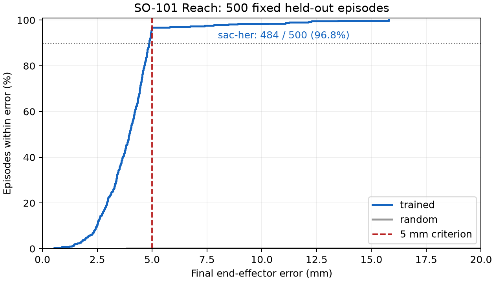

# SO-101 Reach 5mm — 2026-10-02

**SO-101 5 mm Reach: SUCCESS**

Nominal MuJoCo、固定500 held-out episodes（seed 2000000–2000499）で **484/500 = 96.8%**。
判定は最終true end-effector distance **<= 0.005m**。到達時にepisodeを終了するため、
これは到達精度であり、その後の長時間hold精度の評価ではありません。targetの事後選別はしていません。

## Environment / observation / action / reward

- Apple M1、16 GiB、aarch64-darwin、Nix devShell。Python 3.12.14、Rust 1.98.1。
- MuJoCo 3.10.0 / rusty_mujoco 0.4.0。Menagerie c96a32d28fb5da84da38c1da4d749e7a13212855。
- SO-101: robotstudio_so101/so101.xml、site gripperframe（固定jaw側、moving gripper jointの外）。モデル／gain／force／collisionを変更していない。
- RobotSpecの6 actuatorは維持。Reach actionは shoulder_pan, shoulder_lift, elbow_flex, wrist_flex, wrist_roll。gripper targetはhome=0rad。
- observation: selected joint q(5), qvel(5), end-effector XYZ(3) = 13 float32。achieved_goal / desired_goalは各XYZ(3)、meter。
- Action: [-1,1]^5。measured q + action * 0.05rad、previous targetから0.1rad/step rate limit、model-derived safe range clamp。IKはこのRL actionに使っていない。
- Reward: -||achieved_goal-desired_goal|| / 0.1、success bonus=0。HERはgoalsのみからvectorized再計算。
- Physics dt=0.005s、control/Gym period=1/30s、horizon=100 control steps。時間drift防止の既存schedulerを維持。
- 5% joint margin付きvalid qをsampleしてFK targetを生成。最終target距離0.05–0.25m。reset stateは生成qへ移動しない。hidden qはPythonへ非公開。
- Trainingは固定horizon timeout、successでterminatedにしない。SB3 HERはrewardを再計算するがdonesを保持するため。evaluationはnative successでterminated、horizonでtruncated。

## IK validation

500 targets（seed1000000–1000499）: **99.6%**、median 2.722mm、P95 4.718mm。
初期の積算target controllerは27.8%だった。測定qを基準にq + DLS correctionへ変更して99.6%となった。
Numerical FK Jacobian、lambda=0.01、各dq limit=0.05rad、30Hz。500件中2件は300 control stepsで5mm未達（seed1000194:14.663mm、1000197:11.606mm）。
DLSはvalidation専用。targetを作ったjoint configurationを使わず、target XYZと現在qだけを使う。
[Raw IK result](results/reach5mm-ik.json)。

## Algorithm / hyperparameters

Stable-Baselines3 2.9.0、Torch 2.14.0、SAC + HerReplayBuffer、MultiInputPolicy、CPU single thread。
future strategy、n_sampled_goal=4。buffer_size=1,000,000、batch=256、lr=0.001、gamma=0.98、tau=0.005、
train_freq=16、gradient_steps=4（update/transition ratio=0.25）、learning_starts=1000。actor/critic network [128,128]。
256x256x256もCLIで選べるが、今回の実測は128x128。PPO比較はn_steps256、batch64、epochs5、pi/vf[128,128]、lr0.001。

## Curriculum / replay / resume

| Stage | Target distance | Success threshold | 次stageへ進んだstep |
|---|---|---|---|
| A | 2–8cm | 20mm | 50,016 |
| B | 3–12cm | 10mm | 75,024 |
| C | 5–20cm | 7.5mm | 150,048 |
| D | 5–25cm | 5mm | final |

A–Cは64 held-out seedsで25k stepごとに評価し90%で進行。Dは最初64件だったが、
300,096 step時の64件95.3%に対し別500件88.2%だったため500件へ修正した。
最終500評価と学習中validation500評価は別seed群（1000000–1000499 / 2000000–2000499）。
trainingはseed42から独立RNGでtarget seedsを生成。final seed群をtrainingに投入していない。
300,096（88.2%）と375,120（85.2%）の失敗結果も保存し、評価回数変更・追加学習を隠していない。
最終fixed seed群は追加学習の停止判断に再使用した。完全に一度だけのblind testとは主張しない。
375k以降はvalidation success95%を停止基準に設定。425,136 stepでvalidation500が96.6%となり停止。

Stage間はweight/optimizerを保持しreplayをresetする。保持するablationも200,000 stepまで実行した。
同じ150,048 step／Stage C／64 seedsでreset=95.3%、retained=87.5%。retainedは200kでもC=84.4%でD未到達。
今回reset方式を採用した理由はこの到達速度。reward bonus0でも古いgoal分布がcritic学習へ残る影響があると推測するが、因果は確定していない。
保持する場合はunfinished HER trajectoryをtruncateしてから環境をresetする。

latest.zip / best.zip / latest-replay.pkl / training_state.jsonを保存。resumeはweights/optimizer/replayと
target RNG、NumPy RNG、Torch RNGを復元する。VecEnvのpending seedが保存target RNGを上書きする問題を修正・テストした。
physics stateそのものはresumeせず、新episodeから再開しunfinished replay trajectoryをtruncateする。

主学習 **425,136 environment steps**、training/evaluation/checkpointを含む累計runner時間 **560.80s (9.35min)**。
開始budget500k、最大cap5M。nominal条件を425kで達成したため1M/2M/5Mへ延長せず、Cartesian actionも追加しなかった。


500 held-outで基準を満たしたのはJoint Delta SAC+HERであり、古典IKを学習policyとして扱っていない。

## Short comparisons (final 5mm environment)

各25k程度、同じ128 held-out seeds1500000–1500127、no curriculum。短期比較であり、PPO/SACの収束性能比較ではない。

| Algorithm | max_delta rad | Actual steps | Success | Median mm | P95 mm |
|---|---:|---:|---:|---:|---:|
| ppo | 0.05 | 25,088 | 0.0% | 290.224 | 439.146 |
| sac | 0.05 | 25,008 | 0.8% | 43.382 | 104.926 |
| sac-her | 0.05 | 25,008 | 11.7% | 35.622 | 140.290 |
| sac-her | 0.02 | 25,008 | 1.6% | 62.337 | 119.381 |
| sac-her | 0.01 | 25,008 | 1.6% | 64.513 | 160.797 |

0.05radがこの短期条件で最も進んだため主学習に採用。continuous actionなので0.05radは量子化resolutionではない。
[Raw comparisons](results/reach5mm-short-comparison.json)。

## Final 500-episode evaluation

| Policy | Success | Mean error mm | Median mm | P95 mm | Mean length | Mean reward |
|---|---:|---:|---:|---:|---:|---:|
| Random | 0.2% | 267.633 | 276.973 | 417.323 | 99.878 | -236.362764 |
| SAC+HER | 96.8% | 3.937 | 3.961 | 4.963 | 15.120 | -8.011882 |

| Error statistic | mm |
|---|---:|
| P50 | 3.961 |
| P90 | 4.868 |
| P95 | 4.963 |
| P99 | 11.261 |
| max | 15.795 |

| Within | Fraction |
|---|---:|
| 2mm | 4.8% |
| 5mm | 96.8% |
| 10mm | 98.4% |
| 20mm | 100.0% |

| Initial target distance | Episodes | Success |
|---|---:|---:|
| 0.05-0.10m | 37 | 100.0% |
| 0.10-0.15m | 87 | 98.9% |
| 0.15-0.20m | 154 | 98.7% |
| 0.20-0.25m | 222 | 94.1% |

[Raw final evaluation](results/reach5mm-final.json) includes every seed/outcome. 
Near-distance targetsだけで合格にしていない。far20–25cmも222件、94.1%である。

## Failure cases / audit

16件はhorizon100で未到達。worst5はseed2000033/2000427/2000125/2000489/2000180、
error15.795/13.465/12.275/12.227/12.133mm、initial distanceは21.3–24.9cm。
遠距離側のfinite-horizon/learned-controller精度が残る。IK99.6%なので環境全体が5mm不可能という説明にはならない。
ただし16件すべてのIK/collision/limit因果分析や安定hold精度までは実施していない。

確認済み: siteは固定jawのgripperframe、targetはepisode中固定、reset後qはtarget qへ置換しない、
policyにhidden qやrandomization parametersを渡さない、rewardにfuture qを使わない。
HERのfuture achieved goalsはreplay relabellingのみであり、online policyの情報ではない。

## Light DR fine-tuning / robustness

主学習達成後のみlight DRを有効化。baseからfresh replayで75,024 step fine-tuneした。
同じ500 seedsで結果は以下。engineering DR profileであり、実機の測定分布ではない。

| Policy | Nominal | Light | Moderate |
|---|---:|---:|---:|
| Nominal base (採用) | 96.8% | 97.4% | 97.8% |
| Light fine-tuned (不採用) | 86.4% | 94.8% | 80.0% |

fine-tuned候補はnominal86.4%へ悪化したため採用しない。**baseはnominal96.8% / light97.4%**で、
第二目標のnominal90% / light70%も既に満たす。DRの遅延が応答を変えるためperturbationが必ず性能を悪くするとは限らない。
moderateも評価したが実機robustnessの保証にはしない。fine-tuneの改善を捏造せず、元baseを保持する。
[Base robustness](results/reach5mm-base-robustness.json)、[fine-tuned candidate](results/reach5mm-light-robustness.json)。

## Checkpoint / Rerun / W&B

- Adopted: `runs/so101-reach-5mm/best.zip` (425,136 steps)。
- Frozen base: `runs/so101-reach-5mm/base-policy/best.zip` + config.json + artifact.json + evaluation.json。
- Resume: latest.zip + latest-replay.pkl (約196MiB) + training_state.jsonを同じdirectoryで保持。
- `artifact.json`にはrobot/task config、SI units、observation/action schema、scaling、30Hz、seed、algorithm、environment/model versions、training steps。
- `runs/so101-reach-5mm/final-425136-rerun/`にbest5/worst5の10 .rrd files。recordされた全seedはraw evaluationのrerun_filesに列挙。
- Rerun0.38.1: target、end-effector、distance、reward、requested/applied/true/observedの4 joint系列。simulation_time/episode_step/episode/global_step。
- GUIなしのnative log/rrd print検証成功。Viewer起動commandはexit0。GUI目視確認はOS Accessibility/Screen Recording権限待ちで未確認。
- W&B0.30.0 offline runsを `runs/so101-reach-5mm/wandb/` とlight directoryへ保存。actor_loss, critic_loss, ent_coef, ent_coef_loss, learning_rate, n_updatesは実際のSB3 logger値。
  replay size、episode reward/length/success/distance、curriculum/evaluationも記録。cloud同期/loginはしていない。

```bash
nix develop
uv sync --locked --extra learning --no-install-project
maturin develop --features sim-python/rerun
python examples/python/eval_reach.py --robot so101 \
  --model runs/so101-reach-5mm/best.zip --episodes 500 --threshold 0.005
rerun runs/so101-reach-5mm/final-425136-rerun/worst-2000033.rrd
```

## Build / tests / warnings

変更前: cargo fmt --check、clippy、cargo test成功（Rust35件）、maturin develop / pytest成功（Python66件）。
変更後: Rust37件 + optional Rerun SDK1件、Python83件。Rerun feature無効／有効の両方でpytest83件成功。
Panda/UR5eもGoal reset/step、SyncVectorEnv、SAC+HER optimization/replay/save/load/resume/evaluation smokeが成功。
同じCLIでPanda/UR5eも各32 stepのrollout/optimization/checkpoint保存を実行した。
5mm高成功率の長時間学習・500評価を主張するのはSO-101のみ。

```bash
nix develop
cargo fmt --check
cargo clippy --workspace --all-targets
cargo test --workspace
maturin develop
pytest
maturin develop --features sim-python/rerun
pytest
cargo test -p telemetry-rerun --features sdk
```

各phaseでは scripts/check-phase.sh (= fmt/clippy/test) と関連pytestを実行。
実際のlearning commands: eval_reach_ik.py500、train_reach_sac_her.py --curriculum --steps500000 --net-arch128128 --wandb offline、
resume --steps200000、resume --steps124880 --max-steps500000 --validation-success.95、eval_reach.py500 --threshold.005 --record、
短期PPO/SAC/HER各25k、--keep-replay-between-stages200k、--initialize-from --domain-randomization light --steps100000、
eval_robustness.py各500。実行はすべてNix devShell内。早期停止によるactual step数はJSONに記録。
主学習425,136 + short比較125,120 + replay ablation200,000 + light75,024 = **825,280 learning steps**（tiny unit smoke stepsを除く）。

残るwarnings: Nix dirty-tree、cc-wrapperのarm64-apple-macosx/arm64-apple-darwin表記差、
既存RobotEnv checkerのabsolute action推奨警告3件＋unbounded observation警告6件。
途中のresumeでHER unfinished trajectory truncation警告（新episodeへ再開する意図通り）。新DLS clippy warningは修正済み。

## Changed files / boundaries / TODO

| Area | Files |
|---|---|
| Shared task/schema | crates/robotics-core/src/task.rs, trajectory.rs |
| Runtime | crates/mujoco-runtime/src/ik.rs, simulation.rs, randomization.rs, lib.rs; tests/reach.rs, latency.rs, randomization.rs |
| Recording/binding | crates/trajectory-io/src/lib.rs; crates/sim-python/src/lib.rs, worker.rs |
| Python | python/robot_sim/goal_env.py, goal_learning.py, precision.py, selection.py, ik.py, trajectory.py, __init__.py; profiles/light.toml, moderate.toml |
| Examples | eval_reach_ik.py, train_reach_sac_her.py, eval_reach.py, eval_robustness.py, plot_reach_evaluation.py |
| Tests/config | pyproject.toml / uv.lock（optional analysis/matplotlib）、tests/python/test_goal.py, test_her.py, test_trajectory.py, test_telemetry.py; configs/domain_randomization/*, models/identified/example-so101.json |
| Docs/results | README.md, docs/ARCHITECTURE.md, SIM_TO_REAL.md, VALIDATION.md, this file and docs/results/reach5mm-*.json |

Rust coreはphysics/task/safetyのまま。SAC/HER/curriculum/W&BはPython、Rerunはoptional sink。
Trajectory V2はissue/application/delivery/source時刻、requested/applied targetsを分離。V1読み込み互換。
Command alignmentはZero-Order Hold、stateはlinear interpolation。sensor_zero_offset_radへrename、旧名はread aliasのみ。
新しいunsafeは追加していない。残る4 unsafe blocks: model_access.rsのactuator transmission取得（10）、
parameter読込（33）、reset時書込（53）、simulation.rsのmatching model/data site_xpos（626）。
C側でID/hinge/DOF範囲を検証し、buffer長7、borrow/exclusive accessを守り、pointerを保持しない。
unsafe extern宣言2箇所。unsafe Send/Syncなし。

TODO: actuator_zero_offset、backlash/compliance/電源温度/慣性/接触/実機通信jitterのモデル、
steady hold検証、real trajectory calibration、sensor timestampsの取得、real motor limits/安全停止。
camera RGB renderingとLeRobot plugin/serial driverは今回未実装。次の最小実装はnamed RobotIoの
実機adapter＋JointCodec校正＋V2 timestamp付きtrajectory計測であり、実機RLから始めない。
SAC/HER APIは [SB3公式HER docs](https://stable-baselines3.readthedocs.io/en/master/modules/her.html)、
[GoalEnv conventions](https://robotics.farama.org/main/content/multi-goal_api/)とinstalled2.9.0 sourceを確認した。

Optional static plot: `uv sync --locked --extra learning --extra analysis --no-install-project`、
`maturin develop --features sim-python/rerun`、`python examples/python/plot_reach_evaluation.py`。
PNG/PDFは実測JSONから生成し、matplotlibはsimulation/learningの必須依存ではない。
